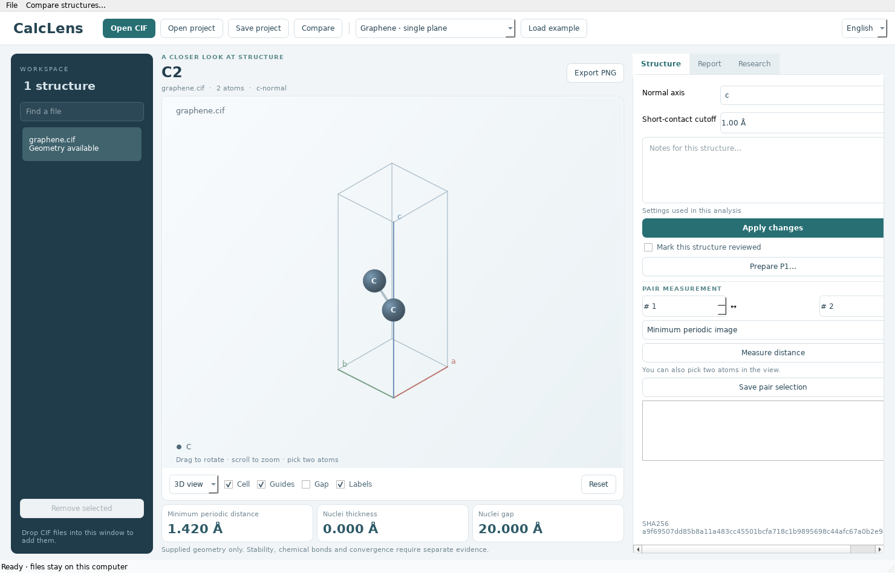

# CalcLens

**Desktop 0.10.0** opens CIFs in a native desktop program. The Windows folder ZIP and Apple Silicon app include automatic recovery, electronic fields, Apple Metal/CUDA or a remote worker, Gaussian output review and a real vacuum-convergence case. Device availability depends on the computer and selected task. [Desktop guide](docs/DESKTOP.md)

Extract the complete Windows ZIP into an empty folder and launch `CalcLens.exe` beside `runtime`. Keep the extracted folder together. **Settings** opens device selection, theme, interactive graphics and PNG options. The H₂ project keeps its original calculation axis when the structure axis changes. [Desktop guide](docs/DESKTOP.md) · [Viewer features](docs/native-graphics.md) · [Pre-release review record](docs/NATIVE_REVIEW.md)

[Windows x64 folder ZIP](https://github.com/a123qsd/calclens/releases/download/v0.10.0/CalcLens-0.10.0-Windows-x64-folder.zip) · [Apple Silicon Mac DMG](https://github.com/a123qsd/calclens/releases/download/v0.10.0/CalcLens-0.10.0-macOS-Apple-Silicon.dmg) · [Release files](https://github.com/a123qsd/calclens/releases/tag/v0.10.0)

Created, led and maintained by [a123qsd](https://github.com/a123qsd).
[Project origin and responsibilities](AUTHORS.md) · [Citation](CITATION.cff)

**Inspect the geometry of a 2D material CIF before setting up a calculation.**

View atoms and the cell, find short periodic contacts and duplicate sites, and
measure the span of nuclear positions and the largest empty interval along a
selected normal axis (a, b, or c).
The app runs locally after installation. No external API key or paid computation
service is required.

[Project home](https://github.com/a123qsd/calclens) · [한국어 안내](README.ko.md) · [English ZIP and installation](docs/DOWNLOADS.md#english) · [Methods and limits](docs/METHODS.md) · [Example provenance](docs/PROVENANCE.md) · [Development](docs/DEVELOPMENT.md) · [Validation record](docs/VALIDATION.md)

Version 0.10.0 compares Gaussian and VASP output geometries by atom index,
integrates Cube and CHGCAR density fields, replays retained density results on
the CPU and exports PNG or PDF figures at a specified print width and resolution.
See the [0.10.0 release notes](docs/RELEASE-0.10.0.md).

The optional browser viewer includes ball-and-stick, stick and space-filling views, element
legends, metal-element highlighting, graphics quality, top/side views,
orthographic projection, fullscreen, linked comparison cameras and 1600/3200-pixel
PNG export. Display counts and label/connection caps are visible.

Use **Charge & electronic surface data** to download a source-matched JSON
template or import a Cube grid. Partial, formal and ionic charges and oxidation
states have distinct meanings; missing values remain unknown. Density and
orbital displays use supplied grids, without electronic-structure calculations.
Electronic files, drafts and viewer settings are included in portable ZIP projects.
A structure can have multiple datasets, with independent selections and shared
charge scales in Compare. See the [workspace guide](docs/WORKSPACE_SAVE.md) and
[real H2O calculation case](docs/ELECTRONIC_CASE.md). See [Imported viewer data](docs/VIEWER_DATA.md) for formats,
coordinate matching and units.



[Watch the earlier Streamlit demo](docs/assets/calclens-demo.webm) ·
[Read the public graphite case](docs/CASE_STUDY.md)

> This tool does not establish structural stability or calculation accuracy.
> Its gap is a geometric measurement between nuclear positions.
> Vacuum sufficiency requires convergence tests in the intended calculation.

## Run locally

On Windows, extract the complete ZIP into a new folder and open `CalcLens.exe` beside `runtime`. Keep the extracted folder together, including when moving the app. On an Apple Silicon Mac, open the DMG, drag CalcLens into Applications, and open the app. Both builds include Python and Qt. A graphene example opens on first launch.

[Windows x64 folder ZIP](https://github.com/a123qsd/calclens/releases/download/v0.10.0/CalcLens-0.10.0-Windows-x64-folder.zip) · [Apple Silicon Mac DMG](https://github.com/a123qsd/calclens/releases/download/v0.10.0/CalcLens-0.10.0-macOS-Apple-Silicon.dmg) · [Release files](https://github.com/a123qsd/calclens/releases/tag/v0.10.0)

[Source ZIP](https://github.com/a123qsd/calclens/archive/refs/tags/v0.10.0.zip) · [SHA-256 checksums](https://github.com/a123qsd/calclens/releases/download/v0.10.0/SHA256SUMS.txt) · [Installation guide](docs/DOWNLOADS.md#english)

To clone the source with Git instead, use the commands below. These installation
examples use Python 3.12.

```bash
git clone https://github.com/a123qsd/calclens.git
cd calclens
python3.12 -m venv .venv
source .venv/bin/activate
python -m pip install --require-hashes -r requirements.lock
python -m pip install --no-deps --no-build-isolation .
python run_app.py --language en
```

On Windows, create the environment with `py -3.12 -m venv .venv` and activate it
in PowerShell with `.venv\Scripts\Activate.ps1`.
Installing the packages initially requires an internet connection.

The native application opens directly. Choose **Open CIF** or drag a CIF into
the window. Start with graphene, then compare `graphene_duplicate.cif` to see
how a duplicate site is reported. You can switch between English and Korean
in the app. Use `python run_app.py` to restore the saved desktop language, or
a source ZIP's default language. Save your project before closing.

## Molecular workspace

The default application uses Qt. See the [desktop guide](docs/DESKTOP.md) for
its controls and recovery behavior. To open the optional React/TypeScript and
3Dmol.js browser workspace, run `python run_app.py --web-ui`. The file-strip,
tab and server controls described below apply to that browser workspace.
Python owns CIF parsing, geometric measurements and project storage in both
interfaces. The measurements include minimum periodic distance, nuclear-span
thickness and candidate nuclear gap; they do not represent SCF, optimization
or frequency results.
After installing the optional `legacy-ui` extra, the earlier Streamlit screen
remains available with `python run_app.py --legacy-ui`.

Drag the structure to rotate it and scroll to zoom. **Fit atoms** frames the
structure; **Fit cell** includes the full unit cell. Use **Repeat** to display
1×1, 2×2 or 3×3 cells in the two in-plane directions. These copies retain their
original site numbers and lattice image shifts; they do not enlarge the Python
calculation. **Display bonds** toggles distance-inferred sticks. These are
explicitly display-only connections, not a chemical bond analysis.

Select a review check to show its exact sites or periodic image. The minimum
pair remains available even above the warning cutoff. Candidate gap boundaries
show the largest cyclic gap between nuclei, including a boundary crossing.
This gap alone does not establish a physical vacuum or adequate convergence.

## Files, comparison and review

Use **Open files** for a new workspace of up to 20 CIFs, or **Add CIFs** in
**Edit selected structure** to extend the current workspace. Every input keeps
the 2 MiB and 400-site limits. Unsupported files remain in the records table
with blank measurements and an explanation; other files are still analyzed.
Select a record to inspect it. Per-file axis and short-distance cutoff begin at
c and 1.0 Å for uploaded CIFs; set the actual candidate normal before interpreting
a gap. Named a/b-normal examples carry their corresponding axis.

The edit panel provides notes, source replacement and removal. **Apply changes**
updates the analysis conditions; **Save project** also preserves unapplied drafts.
Replacing a file preserves its ID, notes and settings, but changed bytes clear
review completion and saved pair selections. Removal changes this workspace only; it does not delete a file
from your computer. At least one entry must remain.

Geometry flags and review progress have independent filters. **Reviewed** is a
human record, not a passing geometry result. A review stamp records the exact
original hash, axis, cutoff, analysis revision and ASE version. Changed analysis
conditions require rechecking while the historical stamp remains available.
An app-version change alone does not invalidate a current stamp. Schema-1
projects from v0.3.0 open with their originals and notes, but require rechecking
because they have no analysis revision.

**Compare structures** displays two structures side by side, their settings,
cell vectors, measurements and changes in findings. Differences mean comparison
minus reference; the app does not establish atom correspondence or calculate RMSD.
**Export all CSV** includes every entry regardless of the visible filters.

## Pair measurements and saved work

Click atoms in the viewer or enter two distinct original site numbers in
**Measure atom pair**. Set each displayed image's integer `[a,b,c]` shift if
needed. The panel distinguishes the chosen-image distance from the minimum-image
distance. Save up to 50 selections per entry; distances are recalculated from
the original source when reopening. Index fields explicitly identify their
numbering convention; raw JSON indices are zero based.

**Save project** downloads a `.calclens.zip` containing original CIF bytes,
IDs, settings, notes, review stamps, selections, drafts, imported electronic files
and viewer state. Older schema-1/2 JSON projects remain readable. **Open project**
restores it and recomputes reports. Corrupt payloads, missing originals and hash
mismatches are rejected. Report JSON/CSV downloads are evidence exports and
cannot be imported as projects.

Tabs of one running server share a workspace. A conflicting edit from a stale
tab reloads the latest state and asks you to review it before retrying; it does
not silently overwrite newer work. Work remains in memory until downloaded.
Save a project before stopping the server.

## Command line

Run the same check from the command line and save a JSON report:

```bash
calclens examples/graphene.cif --normal-axis c --language en --json report.json
calclens examples/mos2_a_normal.cif --normal-axis a --language en --csv report.csv
```

Choose either `--json` or `--csv` per command. Both create a new file and refuse
to overwrite an existing one. CSV site numbers start at 1; JSON atom indices
start at 0. Exit codes
are `0` for no error-level findings (warnings may remain), `1` for a geometric
error such as overlapping sites, and `2` for unsupported input, read, argument,
or output errors.

## Report language

Under **Method notes**, the report-language selector defaults to “Same as interface.” You can choose
English or Korean independently before downloading JSON or CSV. Downloads use
`_calclens_en` or `_calclens_ko` in the filename. The CLI uses English by default;
pass `--language ko` for Korean explanations or `--language en` for English.
The ZIP's default interface language does not change that CLI default.

JSON keeps canonical English field names, issue codes, severity values, units,
atom indices, and all numerical results unchanged. `report_language` identifies
the selected language. Human-readable issue messages, assumptions, and
limitations use that language. Korean JSON also preserves the original English
text in `message_en`, `assumptions_en`, and `limitations_en` fields.

CSV headings and explanation text follow the chosen language. Technical values
such as issue codes, record types, severity, and units remain stable identifiers
for comparison and automated processing. Korean CSV files from the app and CLI
use UTF-8 with a BOM for spreadsheet compatibility; JSON uses UTF-8 without a BOM.
Changing language does not change the scientific criteria or results.

## Source identity and contact evidence

App and CLI JSON/CSV reports include the original filename, the SHA-256 of the
exact file bytes, the CalcLens package version, and the ASE version. The hash is
computed before decoding or newline conversion, so a line-ending change produces
a different file identity even if the measured geometry stays the same.

JSON stores these fields in `provenance`. CSV uses `provenance` rows and keeps a
`minimum_pair` row with site numbers, elements, distance, and periodic image shift,
including when the short-contact list is empty. Distance findings retain exact
`contact_count` values and a `representative_contact`; CSV exports the representative
as an `issue_contact` row. These are screening records, not a complete neighbor list.

## Read the results

| Result | Meaning |
| --- | --- |
| Structure and cell | Positions and element identities, with highlights for selected atoms, contacts, and periodic images. Marker size is not an atomic radius. |
| Minimum periodic distance | Closest nuclear separation across cell boundaries, including an atom's nonzero periodic self-images. |
| Short contacts and overlaps | Distances below 1.0 Å are flagged by default. This configurable threshold is not an element-specific bond criterion. |
| Nuclei-span thickness | The selected-normal range of nuclear positions after removing the largest empty cyclic interval. It is not a physical material thickness. |
| Nuclei gap | Largest interval without a nucleus along a cyclic traverse of the selected normal axis. It is not an electron-density-free vacuum width. |
| Review notes | Unsupported input is distinguished from ambiguous geometry. An absence of warnings does not validate a calculation. |

A single atomic plane has a nuclei-span thickness of `0 Å`.
This does not imply that graphene has zero physical thickness.

## Supported input

- One **CIF 1.x P1 data block**, with every site explicitly listed
- Fractional coordinates, standard element symbols, and fully occupied sites
- A selected layer-normal axis (a, b, or c) perpendicular to the other two cell vectors
- At most 2 MiB and 1–400 sites per file

Non-P1 symmetry, partial or mixed occupancy, modulated, superspace, or composite
structures, a selected axis tilted relative to the other two vectors, and
multiple data blocks are unsupported. General CIF files can use symmetry-equivalent
positions or occupancy alternatives; treating these as accidental duplicates and
deleting them would be unsafe. CalcLens stops with an explanation instead.

Review occupancy separately in a suitable structure tool, then export a fully
expanded P1 structure if appropriate. Do not simply relabel a symmetry-reduced
CIF as P1 or delete sites to make it pass. Check the converted coordinates and
whether the selected axis is the intended slab normal.

For multiple layers or bulk-like structures, the largest empty interval may not
be the intended vacuum. Warnings catch some ambiguous cases using explicit
heuristics; they do not detect every multilayer or bulk structure.
Ambiguous results are marked for review.

The geometry checks do not establish SCF convergence, successful optimization
or vibrational stability. The desktop's separate research tools can review
Gaussian output records and compute density differences and planar averages
from supplied grids. They do not run Gaussian/ORCA or solve for an electronic
structure; ORCA log analysis is outside this release.
See [METHODS.md](docs/METHODS.md) for geometry tolerances and equations and
[the desktop guide](docs/DESKTOP.md) for the research tools.

## Examples and verification

The [examples](examples/README.md) include idealized graphene, h-BN, and MoS₂
models, plus deliberately altered structures with overlaps, short contacts,
and a layer crossing the cell boundary. They were generated for this repository;
they are neither experimental structures nor relaxed research results.

The separate [public graphite case](docs/CASE_STUDY.md) starts from a published
Crystallography Open Database record and documents its conversion and limitations.

```bash
python scripts/generate_examples.py --check
python -m pytest
```

Tests cover analytical distances and gaps, an independently enumerated periodic
image reference, translation invariance, duplicates across a cell boundary,
units, and unsupported inputs. The scope is geometric and software verification.
CalcLens itself does not run energy, force or electronic-structure calculations.
The separate [water example](docs/ELECTRONIC_CASE.md) includes an actual PySCF
calculation and checks for importing its results.

## Tools used

[ASE](https://docs.ase-lib.org/) supplies CIF parsing and periodic geometry.
React and TypeScript provide the workspace; 3Dmol.js draws the molecular viewer.
Streamlit and Plotly are optional dependencies for the legacy interface (`--legacy-ui`).
[pymatgen](https://pymatgen.org/) also supports CIF and materials analysis.
CalcLens adds a narrow input contract and beginner-facing explanations to
existing tools; it does not replace general materials analysis or simulation software.

## Files and privacy

The app has no feature that sends a CIF to an external AI or analysis API.
In a local session, the browser sends the file to the local Python server on the
same computer. The default workspace binds only to loopback. If someone hosts
the legacy interface remotely, that server receives the file;
check its operating environment before supplying unpublished research data.
Use only shareable, minimal examples in public bug reports.

## License

Personal, educational, academic, and internal organizational or business use
is free. Modification and free redistribution are permitted under the license.
Selling the program, charging for its use or access, or offering its functionality
as a paid service requires the copyright holder's prior written permission.
Genuinely free inclusion alongside an unrelated paid product is permitted when
no consideration is for the program itself, its use, or access.
These restrictions do not apply to research results, figures, reports, or other outputs.

This is **source-available software**, not OSI-approved open source, because sale
and paid services are restricted. [LICENSE](LICENSE) contains the governing terms.
Dependencies retain their own licenses; see [THIRD_PARTY_NOTICES.md](THIRD_PARTY_NOTICES.md).

For the previous Streamlit interface, install `.[legacy-ui]` or the pinned
`requirements-legacy.lock` environment before launching with `--legacy-ui`.
The default installation excludes Streamlit and Plotly.
