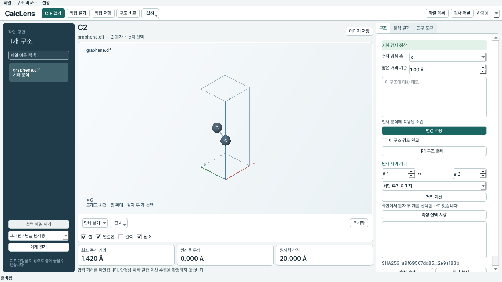

# CalcLens

**0.9.0 데스크톱 안내** · Windows EXE 또는 Apple Silicon용 `CalcLens.app`을 열면 파일과 구조 뷰가 앱 안에 표시됩니다. 자동 복구, 전자 자료, Apple Metal·CUDA·원격 계산, Gaussian 로그 및 실제 수렴 예제를 사용할 수 있습니다. [데스크톱 실행·사용 안내](docs/DESKTOP.md)

**검토용 수정 빌드.** Windows에서는 검토 ZIP 전체를 빈 폴더에 풀고 그 안의 `CalcLens.exe`를 실행하세요. 아래 링크는 기존 공개 0.9.0 배포본입니다. 수정 빌드는 주 분석 축을 바꿔도 H₂ 계산 당시의 축과 원본을 보관합니다. 상단 **설정**에서 계산 장치, 테마, 그래픽 품질과 PNG 출력을 선택할 수 있습니다. [사용 안내](docs/DESKTOP.md) · [뷰어 기능 비교](docs/native-graphics.md) · [검증 기록](docs/NATIVE_REVIEW.md)

[공개 0.9.0 Windows EXE](https://github.com/a123qsd/calclens/releases/download/v0.9.0/CalcLens-0.9.0-Windows-x64.exe) · [Apple Silicon Mac DMG](https://github.com/a123qsd/calclens/releases/download/v0.9.0/CalcLens-0.9.0-macOS-Apple-Silicon.dmg) · [전체 배포 파일](https://github.com/a123qsd/calclens/releases/tag/v0.9.0)

창안·기획·개발 총괄 및 유지관리: [a123qsd](https://github.com/a123qsd).
[프로젝트 출처와 역할](AUTHORS.md) · [인용 정보](CITATION.cff)

**2차원 물질 계산을 시작하기 전, CIF 구조의 기하 정보를 확인하는 도구입니다.**

CIF 파일에서 원자 위치와 셀을 그려 보고, 주기 경계를 넘는 짧은 원자 간 거리,
중복 원자, 층의 원자핵 기준 두께와 가장 큰 빈 간격을 살펴볼 수 있습니다.
설치 후에는 로컬에서 실행하며, 외부 API 키나 유료 계산 서비스가 필요하지 않습니다.

[Project home](https://github.com/a123qsd/calclens) · [English guide](README.en.md) · [한국어 ZIP 받기·설치](docs/DOWNLOADS.md#한국어) · [계산 방법과 한계](docs/METHODS.md) · [예제 출처](docs/PROVENANCE.md) · [개발 안내](docs/DEVELOPMENT.md) · [검증 기록](docs/VALIDATION.md)

**CalcLens v0.8.0**은 선택한 파일명을 화면 제목으로 표시하고 구조 뷰어를 넓혔습니다.
가로 메뉴, 파일 열기·작업 저장, 파일 선택 줄과 간결한 수치 패널을 현재 구조 주변에
배치했습니다. 자세한 내용은 [0.8.0 변경 사항](docs/RELEASE-0.8.0.md)을 참고하세요.

0.6.0의 뷰어에는 구·막대/막대/공간 채움, 원소 범례와 금속 원소 강조,
그래픽 품질, 위·옆 시점과 정사영, 전체 화면, 비교 시점 동기화 및
1600/3200픽셀 PNG 저장이 포함됩니다. 표시 원자 수와 라벨·연결 제한도 확인할 수 있습니다.

**전하·전자 표면 자료**에서 현재 CIF에 맞는 JSON 서식을 저장하거나 Cube 파일을
불러올 수 있습니다. 부분전하·형식전하·이온 순전하·산화수는 구분되며, 값이 없으면
정보 없음으로 표시합니다. 전자밀도·오비탈은 가져온 격자만 표시하며 계산하지 않습니다.
전자 자료·초안·뷰어 설정은 작업 ZIP에 함께 저장합니다. 같은 CIF의 여러 계산 결과를
각 뷰어에서 고르고, 공통 전하 색상 범위로 비교할 수 있습니다.
[새 작업 안내](docs/WORKSPACE_SAVE.md)와 [실제 H2O 계산 사례](docs/ELECTRONIC_CASE.md)를 참고하세요.
파일 형식·좌표 및 단위 조건은 [보조 자료 안내](docs/VIEWER_DATA.md)를 참고하세요.



[이전 Streamlit 화면 사용 영상](docs/assets/calclens-demo.webm) ·
[공개 흑연 구조 검사 사례](docs/CASE_STUDY.md)

> 이 도구는 구조의 안정성이나 계산의 정확성을 판정하지 않습니다.
> 표시되는 간격은 원자핵 위치로 계산한 기하 정보입니다.
> 진공 간격이 충분한지는 실제 계산에서 별도로 수렴 검증해야 합니다.

## 빠르게 실행하기

공개 0.9.0 Windows EXE는 바로 실행할 수 있습니다. 이번 수정 빌드는 ZIP 전체를 풀고 그 안의 실행 파일을 여세요. Apple Silicon Mac에서는 DMG를 열고 CalcLens를 응용 프로그램 폴더로 옮긴 뒤 실행하세요. 두 배포판 모두 Python을 포함합니다. 앱을 열면 기본 그래핀 예제가 표시됩니다.

[공개 0.9.0 Windows EXE](https://github.com/a123qsd/calclens/releases/download/v0.9.0/CalcLens-0.9.0-Windows-x64.exe) · [Apple Silicon Mac DMG](https://github.com/a123qsd/calclens/releases/download/v0.9.0/CalcLens-0.9.0-macOS-Apple-Silicon.dmg) · [전체 배포 파일](https://github.com/a123qsd/calclens/releases/tag/v0.9.0)

[소스 ZIP](https://github.com/a123qsd/calclens/archive/refs/tags/v0.9.0.zip) · [다운로드·설치 안내](docs/DOWNLOADS.md#한국어)

Git으로 소스를 내려받는 경우에는 다음 명령을 실행합니다.
설치 명령 예시는 Python 3.12를 사용합니다.

```bash
git clone https://github.com/a123qsd/calclens.git
cd calclens
python3.12 -m venv .venv
source .venv/bin/activate
python -m pip install --require-hashes -r requirements.lock
python -m pip install --no-deps --no-build-isolation .
python run_app.py --language ko
```

Windows에서는 가상환경을 `py -3.12 -m venv .venv`로 만들고,
PowerShell에서 `.venv\Scripts\Activate.ps1`로 활성화합니다.
처음 패키지를 설치할 때는 인터넷 연결이 필요합니다.

브라우저가 자동으로 열리지 않으면 터미널에 표시된 로컬 주소를 여세요.
**예제 불러오기**로 예제를 열거나 **파일 열기**로 CIF 파일을 넣습니다.
그래핀 예제로 화면을 익힌 뒤 `graphene_duplicate.cif`를 열면 중복 원자를
어떻게 표시하는지 비교할 수 있습니다. 화면에서 한국어와 영어를 전환할 수 있습니다.
ZIP의 기본 언어로 실행하려면 `python run_app.py`를 사용하세요. 소스에서 실행한
서버는 작업을 저장한 뒤 실행 터미널에서 `Ctrl+C`로 종료합니다.

## 입체 구조 작업공간

기본 화면은 React·TypeScript와 함께 포함된 3Dmol.js 뷰어를 사용합니다.
CIF 해석, 기하 계산과 프로젝트 저장은 기존 Python이 담당합니다. 파일 선택 줄에서
현재 CIF를 고르면 넓은 영역에 구조를 표시합니다. 주변의 조작 버튼과 간결한 수치
패널에서 최소 주기 거리, 핵 중심 두께, 후보 핵 간격을 확인합니다.
SCF·최적화·진동수 분석 결과가 아닙니다. 선택 의존성 `legacy-ui`를 설치하면 이전 Streamlit 화면도
`python run_app.py --legacy-ui`로 열 수 있습니다.

구조를 드래그하면 회전하고, 스크롤하면 확대·축소합니다. **원자 맞춤**은 원자 구조를,
**셀 맞춤**은 전체 단위 셀을 화면에 맞춥니다. **반복**에서 층 안쪽 두 방향을
1×1·2×2·3×3으로 표시할 수 있습니다. 반복한 원자에도 원래 번호와 주기 이동값이
연결되며 Python의 계산 대상은 그대로입니다. **추정 연결**로 막대를 켜고 끌 수 있습니다.
막대는 거리로 추정한 표시용 연결이며, 화학 결합을 분석한 결과가 아닙니다.

검토 항목을 선택하면 계산에서 찾은 원자와 주기 이미지를 강조합니다. 경고 기준보다
멀더라도 최소 거리의 원자쌍은 확인할 수 있습니다. 핵 간격은 주기 경계를 넘는 경우를
포함한 가장 큰 핵 사이 간격입니다. 이 값만으로 실제 진공 영역이나 수렴 여부를 판단하지 않습니다.

## 파일·비교·검토

**파일 열기**로 최대 20개 CIF의 새 작업을 열거나, **선택 구조 편집**의 **CIF 추가**로
현재 작업에 더합니다. 파일당 2 MiB·400개 원자 제한은 같습니다. 분석할 수 없는 파일도
기록 표에 남기고, 측정값 대신 빈칸과 이유를 보여 줍니다. 다른 파일은 계속 검사합니다.
행을 선택하면 해당 구조가 열립니다. 업로드한 파일의 축·거리 기준은 c축·1.0 Å로
시작하므로 실제 층 방향에 맞게 바꾸세요. a·b축 수직 방향의 내장 예제는 해당 축으로 열립니다.

편집 패널에서 메모, 조건, 원본 교체와 삭제를 다룹니다. **변경 적용**으로 검사 조건을
반영하며, **작업 저장**에는 아직 적용하지 않은 초안도 포함됩니다.
원본을 교체해도 ID·메모·조건은 유지하지만, 바이트가 달라지면
검토 완료와 저장한 원자쌍 선택은 초기화됩니다. 삭제는 현재 작업에서만 이루어지며
컴퓨터의 원본 파일은 지우지 않습니다. 작업에는 파일이 하나 이상 남아 있어야 합니다.

구조 상태와 검토 진행 상황을 각각 필터링할 수 있습니다. **검토 완료**는 사람이 확인했다는
기록이며, 구조 경고는 계속 표시됩니다. 완료 당시 원본 해시·축·거리 기준·계산 방식·ASE
버전을 남깁니다. 관련 조건이 바뀌면 재검토가 필요하고 이전 기록은 보존합니다.
화면만 바뀐 앱 버전은 완료 상태를 해제하지 않습니다. v0.3.0 작업도 원본과 메모를 복원하지만,
계산 방식 기록이 없으므로 검토 완료를 다시 확인해야 합니다.

**구조 비교**에서는 두 구조, 조건, 셀 벡터, 측정값과 경고 변화를 나란히 봅니다.
변화량은 ‘비교 − 기준’이며, 원자별 대응이나 RMSD는 계산하지 않습니다.
**전체 CSV**에는 화면 필터와 관계없이 모든 파일이 들어갑니다.

## 원자 거리와 작업 저장

뷰어에서 원자를 누르거나 **원자 거리 측정**에 서로 다른 원래 원자 번호 두 개를 입력합니다.
필요하면 각 이미지의 정수 이동 `[a,b,c]`를 지정하세요. 선택한 이미지 사이 거리와
최소 이미지 거리를 따로 보여 줍니다. 파일마다 최대 50개 선택을 저장할 수 있고,
작업을 다시 열면 원본으로 거리를 다시 계산합니다. 번호 입력란의 표기 기준을 확인하세요.
원시 JSON의 원자 인덱스는 0부터 시작합니다.

**작업 저장**으로 원본 CIF 바이트, ID, 조건, 메모, 검토 이력, 원자쌍 선택과 필터를
초안·전자 자료·뷰어 설정과 함께 `.calclens.zip`에 담습니다. 이전 `.calclens.json`도 읽습니다. **작업 열기**에서 복원하면 현재 엔진으로 보고서를 다시 계산합니다.
원본이 없거나 손상되었거나 해시가 맞지 않으면 불러오기를 거부합니다.
결과 기록용 JSON·CSV 보고서는 작업 파일로 불러올 수 없습니다.

같은 서버에서 연 탭들은 하나의 작업을 공유합니다. 오래된 탭에서 편집 충돌이 생기면
최신 상태를 다시 불러와 확인하도록 안내하며, 최신 작업을 덮어쓰지 않습니다.
내려받기 전까지 작업은 메모리에만 있으므로 서버를 종료하기 전에 저장하세요.

## 명령행으로 실행하기

명령행에서 같은 검사를 실행하고 JSON 결과를 저장할 수도 있습니다.

```bash
calclens examples/graphene.cif --normal-axis c --language ko --json report.json
calclens examples/mos2_a_normal.cif --normal-axis a --language ko --csv report.csv
```

`--json`과 `--csv`는 한 번에 하나만 지정하며, 새 파일에만 저장하고 기존 파일을 덮어쓰지 않습니다.
CSV의 원자 번호는 1부터, JSON의 원자 인덱스는 0부터 시작합니다. 종료 코드는
`0`(오류 수준 항목 없음, 경고는 있을 수 있음), `1`(겹침 등 기하 오류),
`2`(미지원 입력·읽기·인수·출력 오류)입니다.

## 결과 언어 선택

**방법과 한계**의 보고서 언어는 기본적으로 ‘화면 언어와 같게’입니다. JSON·CSV를 내려받기 전에
영어 또는 한국어를 별도로 고를 수도 있습니다. 다운로드 파일명에는
`_calclens_en` 또는 `_calclens_ko`가 붙습니다. 명령행의 기본 결과 언어는 영어이며,
한국어 설명은 `--language ko`, 영어 설명은 `--language en`으로 지정합니다.
ZIP의 기본 화면 언어는 명령행의 기본 결과 언어를 바꾸지 않습니다.

JSON의 필드 이름, 오류·경고 코드, 심각도 값, 단위, 원자 인덱스와 수치는 유지합니다.
`report_language`에 선택한 언어를 기록하고, 점검 항목의 설명·가정·한계를 번역합니다.
한국어 JSON에는 영문 원문도 `message_en`, `assumptions_en`, `limitations_en`에 남깁니다.

CSV의 열 제목과 설명문도 선택한 언어로 제공하지만, 항목 코드·행 유형·심각도·단위는
비교와 자동 처리에 사용할 수 있도록 표준 식별자를 유지합니다. 앱과 명령행에서 저장하는
한국어 CSV는 스프레드시트 호환성을 위해 BOM이 있는 UTF-8을 사용하고,
JSON은 BOM 없는 UTF-8로 저장합니다. 언어를 바꿔도 검사 기준과 계산 결과는 같습니다.

## 원본 식별 정보와 접촉 근거

앱과 명령행의 JSON·CSV에는 원본 파일명, 원본 바이트의 SHA-256, CalcLens 패키지 버전과
ASE 버전이 들어갑니다. 디코딩하거나 줄바꿈을 바꾸기 전에 해시를 계산하므로,
같은 구조라도 파일의 줄바꿈이 바뀌면 해시는 달라집니다.

JSON에는 `provenance`에 이 정보를 저장하고, CSV에는 `provenance` 행으로 남깁니다.
짧은 접촉이 없어도 CSV의 `minimum_pair` 행에서 원자 번호·원소·거리·주기 이미지 이동을
확인할 수 있습니다. 거리 진단에는 정확한 `contact_count`와 대표 근거인
`representative_contact`를 보존하며, CSV의 대표 근거는 `issue_contact` 행에 담습니다.
이 기록은 예비 점검용이며 전체 이웃 원자 목록은 아닙니다.

## 무엇을 보여 주나요?

| 결과 | 읽는 방법 |
| --- | --- |
| 원자 구조와 셀 | 원소와 원자 위치를 확인하고 선택한 원자·접촉·주기 이미지를 강조합니다. 화면의 점 크기는 실제 원자 반지름이 아닙니다. |
| 최소 주기 거리 | 이웃 셀까지 고려한 가장 가까운 원자핵 간 거리입니다. 원자와 자기 자신의 주기 이미지도 검사합니다. |
| 짧은 거리와 중복 | 기본 1.0 Å 미만을 검토 대상으로 표시합니다. 원소별 결합 길이를 판정하는 기준이 아닙니다. |
| 원자핵 기준 두께 | 선택한 수직 방향을 따라 가장 큰 빈 간격을 제외한 원자핵 위치의 범위입니다. 물질의 물리적 두께와 다릅니다. |
| 원자핵 기준 간격 | 선택한 방향을 한 주기 돌며 구한 가장 큰 원자핵 없는 구간입니다. 전자 밀도가 없는 공간의 폭을 뜻하지 않습니다. |
| 검토 사항 | 지원하지 않는 입력과 모호한 층 구성을 구분해 설명합니다. 경고가 없다는 이유만으로 계산을 진행해서는 안 됩니다. |

단일 원자 평면인 그래핀 예제의 원자핵 기준 두께는 `0 Å`입니다.
이는 그래핀의 물리적 두께가 0이라는 뜻이 아닙니다.

## 지원 범위

- 원자 위치가 모두 명시된 **P1 CIF 1.x**, 데이터 블록 1개
- 분율 좌표와 정상 원소 기호, 완전 점유된 원자 자리
- 층의 수직 방향으로 a·b·c 중 하나를 선택하며, 그 축이 나머지 두 축에 수직인 셀
- 파일당 최대 2 MiB, 원자 1–400개

P1 이외의 대칭, 부분·혼합 점유, 변조·초공간·복합 결정 구조,
선택한 축이 나머지 축에 수직이 아닌 셀, 여러 데이터 블록은 지원하지 않습니다.
대칭으로 같은 위치를 나타내거나 부분 점유를 표현하는 일반 CIF의 원자를
단순 중복으로 판단해 지우지 않도록, 이런 입력은 이유를 표시하고 중단합니다.

다른 구조 도구에서 점유를 별도로 검토한 뒤 대칭을 전개한 P1 파일로 내보내세요.
공간군 이름만 P1으로 바꾸거나 원자를 임의로 삭제해서는 안 됩니다.
변환한 좌표와 선택한 축이 실제 층의 수직 방향인지도 직접 확인해야 합니다.

층이 여러 개인 구조나 빈 간격이 뚜렷하지 않은 구조에서는 가장 큰 빈 구간이
원하는 진공을 가리키지 않을 수 있습니다. 자동 경고는 일부 모호한 경우를 알리는
경험적 규칙이며, 모든 다층·벌크 구조를 찾아내지는 못합니다.
모호한 결과는 ‘검토 필요’로 읽어야 합니다.

CalcLens는 CIF 기하 검사 도구입니다. Gaussian·ORCA 로그, 계산 실행,
SCF 수렴·구조 최적화·진동수 결과 분석은 지원하지 않습니다.
세부 허용 오차와 계산식은 [METHODS.md](docs/METHODS.md)에 있습니다.

## 예제와 검증

[examples](examples/README.md)에는 그래핀·h-BN·MoS₂의 이상적인 기하 모델과
중복 원자, 짧은 접촉, 경계에 걸친 층 등 의도적으로 바꾼 구조가 있습니다.
모두 이 저장소를 위해 생성한 공개 예제이며 실험 구조나 최적화된 연구 결과가 아닙니다.

[공개 흑연 사례](docs/CASE_STUDY.md)는 Crystallography Open Database의 공개 구조에서
시작합니다. P1 변환 과정과 결과 해석의 한계를 별도로 설명합니다.

```bash
python scripts/generate_examples.py --check
python -m pytest
```

테스트는 해석적으로 구할 수 있는 거리와 간격, 별도로 열거한 주기 이미지,
전체 구조의 평행 이동, 셀 경계의 중복 원자, 단위와 미지원 입력을 확인합니다.
CalcLens 자체는 에너지·힘·전자 구조 계산을 실행하지 않습니다.
별도의 [물 분자 사례](docs/ELECTRONIC_CASE.md)에는 실제 PySCF 계산 결과와
그 자료를 불러오는 과정의 검증이 포함됩니다.

## 사용하는 도구

[ASE](https://docs.ase-lib.org/)의 CIF 파서와 주기 기하 계산을 사용하고,
React·TypeScript로 화면을 구성하고 3Dmol.js로 입체 원자를 그립니다.
Streamlit·Plotly는 선택 의존성이며, 설치한 뒤 `--legacy-ui`로 이전 화면을 사용할 수 있습니다.
[pymatgen](https://pymatgen.org/)도 CIF와 재료 구조 분석을 지원하는 도구입니다.
CalcLens는 이들 도구의 기존 기능 위에 좁은 입력 범위, 설명과 검토 항목을 둡니다.
범용 구조 분석이나 전문 시뮬레이션 도구를 대체하지 않습니다.

## 파일과 개인정보

이 앱에는 외부 AI·분석 API로 CIF를 보내는 기능이 없습니다.
로컬 실행에서는 브라우저가 같은 컴퓨터의 Python 서버로 파일을 전달합니다. 기본 화면은 로컬 접속만 허용합니다.
다른 사람이 운영하는 서버에 배포된 앱을 이용하면 그 서버가 파일을 받으므로,
미공개 연구 자료는 올리기 전에 운영 환경을 확인하세요.
오류를 제보할 때는 공개해도 되는 작은 재현 예제만 첨부하세요.

## 이용 조건

개인·교육·학술 연구와 학교·사업체의 내부 이용은 무료입니다.
조건을 지키는 무료 재배포와 수정도 허용합니다. 프로그램 판매, 프로그램의 사용·접근에 요금을 받는 경우,
프로그램 기능을 제공하는 유료 서비스는 저작권자의 사전 서면 허락이 필요합니다.
프로그램 자체에 요금을 받지 않고 관련 없는 유료 제품에 무료로 함께 제공하는 경우는 허용합니다.
연구 결과·그림·보고서 등 출력물에는 이 제한을 적용하지 않습니다.

판매와 유료 서비스에 제한이 있으므로 **소스 공개 소프트웨어(source-available)**이며,
OSI 기준의 오픈소스로 표기하지 않습니다. 정확한 조건은 영문 [LICENSE](LICENSE)를 따릅니다.
ASE 등 외부 라이브러리의 이용 조건은 각각의 라이선스가 정하며,
[THIRD_PARTY_NOTICES.md](THIRD_PARTY_NOTICES.md)에 출처를 정리했습니다.

이전 Streamlit 화면은 `.[legacy-ui]` 또는 `requirements-legacy.lock`을 설치한 뒤
`--legacy-ui`로 실행합니다. 기본 설치에는 Streamlit과 Plotly가 포함되지 않습니다.
