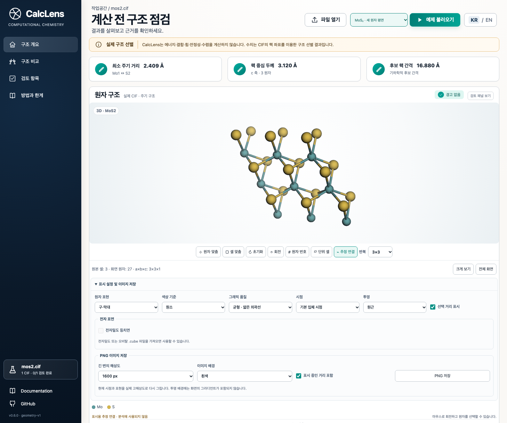

# CalcLens

**CalcLens v0.7.0 source** preserves drafts and viewer settings, saves original
electronic files in portable projects, and compares multiple datasets with a
common charge-color range. It adds validated P1 preparation and an actual
electronic-calculation example. The existing offline 3D workspace, review
history, pair measurements, linked cameras and PNG export remain available.

**CalcLens v0.7.0 소스**는 작성 중인 초안과 뷰어 설정을 유지하고, 전자 자료
원본까지 작업 파일에 저장합니다. 여러 계산 결과를 공통 전하 범위로 비교할 수
있으며, 검증된 P1 준비 기능과 실제 전자구조 계산 사례를 추가했습니다. 기존의
오프라인 3D 작업공간, 검토 이력, 원자쌍 측정, 시점 동기화와 PNG 출력도 제공합니다.

Externally supplied charge JSON and density/orbital Cube files can be displayed
for a matching CIF. CalcLens does not calculate those quantities. Imported viewer
data, per-file drafts and viewer settings are included in portable ZIP projects.
Multiple datasets and shared charge scales support comparisons on the same CIF.
See [Imported viewer data](docs/VIEWER_DATA.md) for formats and limits.

CIF와 일치하는 전하 JSON 및 전자밀도·오비탈 Cube 자료를 불러와 표시할 수 있습니다.
CalcLens가 이 값을 계산하지는 않습니다. 보조 자료, 파일별 초안과 뷰어 설정은 작업 ZIP에 함께 저장합니다.
같은 CIF에 여러 자료를 연결하고 공통 전하 색상 범위로 비교할 수 있습니다. 형식과 제한은
[보조 자료 안내](docs/VIEWER_DATA.md)를 참고하세요.

[0.7.0 workspace guide / 새 작업 안내](docs/WORKSPACE_SAVE.md) · [Real electronic-data case / 실제 계산 사례](docs/ELECTRONIC_CASE.md)

**Published Windows v0.6.0 / 현재 공개된 Windows v0.6.0**

The downloads below predate the 0.7.0 source changes. 아래 배포 파일에는 0.7.0 개선 사항이 포함되지 않습니다.

[한국어 EXE](https://github.com/a123qsd/calclens/releases/download/v0.6.0/CalcLens-0.6.0-windows-x64-ko.exe) ·
[English EXE](https://github.com/a123qsd/calclens/releases/download/v0.6.0/CalcLens-0.6.0-windows-x64-en.exe) ·
[한국어 폴더 ZIP](https://github.com/a123qsd/calclens/releases/download/v0.6.0/CalcLens-0.6.0-windows-x64-ko-folder.zip) ·
[English folder ZIP](https://github.com/a123qsd/calclens/releases/download/v0.6.0/CalcLens-0.6.0-windows-x64-en-folder.zip) ·
[실행 안내](packaging/windows/README.ko.md) · [Windows guide](packaging/windows/README.en.md)

Double-click the EXE to open the launch manager and browser workspace. Use the
manager to reopen the page, view diagnostics, or quit. Closing the manager stops
the server; closing only the browser tab leaves it running. Extract the complete
folder ZIP for faster repeat launches. The executables are unsigned.

EXE를 두 번 클릭하면 실행 관리 창과 브라우저 작업공간이 열립니다. 관리 창에서
화면 다시 열기, 진단 기록 확인과 종료를 할 수 있습니다. 관리 창을 닫으면 서버도
종료되며, 브라우저 탭만 닫으면 계속 실행됩니다. 반복 실행 시간을 줄이려면 폴더 ZIP을
모두 풀어 사용하세요. 실행 파일에는 코드 서명이 없습니다.

**Inspect a 2D material CIF before setting up a calculation.**

CalcLens is a local tool for visualizing atomic structures, finding short periodic
contacts and duplicate sites, and measuring the span of nuclear positions and
the largest empty interval along a selected axis. It includes English and Korean
interfaces, guides, and report explanations, plus analytical examples and
JSON/CSV exports and comparisons of up to 20 CIF files with settings for each file.

**2차원 물질 계산을 시작하기 전, CIF 구조의 기하 정보를 확인하는 도구입니다.**
원자 구조를 그려 보고 주기 경계를 넘는 짧은 거리, 중복 원자, 원자핵 기준 두께와
빈 간격을 확인합니다. 화면·사용 안내·결과 설명을 한국어와 영어로 제공하며,
예제와 JSON·CSV 내보내기, 파일마다 조건을 정하는 최대 20개 CIF 비교를 지원합니다.

[Earlier Streamlit demo / 이전 Streamlit 화면 영상](docs/assets/calclens-demo.webm) ·
[Public graphite case / 공개 흑연 사례](docs/CASE_STUDY.md)

## Download / 다운로드

[Latest release / 최신 배포](https://github.com/a123qsd/calclens/releases/latest)

| Language | Source ZIP for v0.6.0 | Read guide | Download guide |
| --- | --- | --- | --- |
| English | [calclens-0.6.0-en.zip](https://github.com/a123qsd/calclens/releases/download/v0.6.0/calclens-0.6.0-en.zip) | [English](README.en.md) | [English .md](https://github.com/a123qsd/calclens/releases/download/v0.6.0/CalcLens-Guide.en.md) |
| 한국어 | [calclens-0.6.0-ko.zip](https://github.com/a123qsd/calclens/releases/download/v0.6.0/calclens-0.6.0-ko.zip) | [한국어](README.ko.md) | [한국어 .md](https://github.com/a123qsd/calclens/releases/download/v0.6.0/CalcLens-Guide.ko.md) |

[Windows checksums / Windows 체크섬](https://github.com/a123qsd/calclens/releases/download/v0.6.0/WINDOWS-SHA256SUMS.txt) ·
[Windows licenses and build source / Windows 라이선스·빌드 소스](https://github.com/a123qsd/calclens/releases/download/v0.6.0/CalcLens-0.6.0-windows-support.zip)

Both ZIPs contain the same analysis engine and both interface languages. Each
opens in its selected language by default. **Python 3.12 or 3.13 and dependency
installation are required; these are source packages, not standalone executables.**
The browser workspace is included, so Node.js is not required to run them.
The installation examples in the guides use Python 3.12.
Report language follows the interface by default and can be chosen separately.
JSON keys and technical identifiers stay in standard English for compatibility;
human explanations and CSV headings are localized.
See [download and installation instructions](docs/DOWNLOADS.md).

두 ZIP의 검사 기능은 같으며, 처음 열리는 언어와 기본 안내 문서만 다릅니다.
실행 후에도 언어를 전환할 수 있습니다. **Python 3.12 또는 3.13과 의존성 설치가 필요한
소스 패키지이며, 독립 실행 프로그램이 아닙니다.** 화면 파일은 포함되어 있어 실행에
Node.js는 필요하지 않습니다. 안내 문서의 설치 명령 예시는
Python 3.12를 사용합니다. 보고서 언어는 기본적으로 화면 언어를
따르며 별도로 선택할 수도 있습니다. 설명과 CSV 열 제목은 번역하고, JSON 키와 기술
식별자는 호환성을 위해 표준 영문을 유지합니다. [설치 안내](docs/DOWNLOADS.md#한국어)를 확인하세요.

## Save and continue work / 작업 저장하고 이어가기

Use **Save project** to download a `.calclens.zip` containing the original CIFs,
per-file settings, notes, review history, pair selections, drafts, electronic files
and viewer state. Older `.calclens.json` projects remain readable. Use
**Open project** to continue later; measurements are recalculated from the originals.
Save before stopping the server, because unsaved work stays in memory.
See the [English guide](README.en.md#pair-measurements-and-saved-work) for details.

**작업 저장**으로 원본 CIF, 파일별 조건, 메모, 검토 이력과 원자쌍 선택을
전자 자료·초안·뷰어 설정과 함께 `.calclens.zip`에 저장합니다.
**작업 열기**에서는 이전 `.calclens.json`도 읽을 수 있습니다.
측정값은 원본에서 다시 계산합니다. 저장하지 않은 작업은 메모리에만 있으므로
서버를 종료하기 전에 저장하세요.
자세한 내용은 [한국어 안내](README.ko.md#원자-거리와-작업-저장)를 확인하세요.

## What it checks / 검사 범위

- Interactive atoms and cell, with selected contacts and periodic images highlighted
- Minimum periodic distances, overlapping sites, and configurable short-contact screening
- A nearest-pair view that works even when no distance warning is present
- Nuclei-span thickness and largest cyclic gap along a, b, or c
- Up to 20 independent CIF checks, per-file axis/cutoff settings, and a comparison CSV
- JSON/CSV reports with the original filename, SHA-256, CalcLens and ASE versions

원자·셀 시각화, 주기 거리와 겹침 검사, a·b·c 중 선택한 방향의 원자핵 기준
두께·간격 측정을 지원합니다. 경고가 없어도 가장 가까운 원자쌍을 열어 볼 수 있습니다.
비교 표의 행을 선택하면 해당 파일의 상세 결과를 확인하고 JSON·CSV로 내보낼 수 있습니다.

Direct analysis requires one explicit, fully occupied P1 CIF structure, up to 400 sites
and 2 MiB. Comparing files does not combine their structures. The chosen normal
axis must be perpendicular to the other two cell vectors. Gaussian/ORCA logs
and calculation execution are outside this release.
The separate [P1 preparation step](docs/WORKSPACE_SAVE.md#p1-preparation) can expand
supported fully occupied, ordered non-P1 sources after a preview.

직접 분석에는 원자 위치가 명시된 완전 점유 P1 CIF 구조 1개가 필요하며, 파일당 최대 400개
원자·2 MiB까지 지원합니다. 비교할 파일들은 각각 검사합니다.
선택한 수직 방향은 나머지 두 셀 벡터에 수직이어야 합니다.
Gaussian·ORCA 로그 분석과 계산 실행은 지원하지 않습니다.
지원 가능한 완전 점유·무질서 없는 비P1 원본은 별도의 **P1 구조 준비**에서
대칭 전개 결과를 확인한 뒤 적용할 수 있습니다.

> Geometry checks do not establish material stability or calculation accuracy.
> The reported gap uses nuclear positions; vacuum sufficiency requires separate
> convergence tests for the intended calculation.
>
> 기하 검사만으로 물질의 안정성이나 계산 정확성을 보장하지 않습니다.
> 간격은 원자핵 위치로 측정하며, 진공이 충분한지는 실제 계산에서 수렴 검증해야 합니다.

## Details / 자세한 내용

[Methods and limits](docs/METHODS.md) · [Example provenance](docs/PROVENANCE.md) ·
[Public graphite case](docs/CASE_STUDY.md) ·
[Validation record](docs/VALIDATION.md) · [Development](docs/DEVELOPMENT.md) ·
[Dependency notices](THIRD_PARTY_NOTICES.md)

Personal, educational, academic, and internal business use is free. Selling the
software or charging for its use, access, or hosted functionality requires prior
written permission. This is **source-available**, not OSI-approved open source.
The English [LICENSE](LICENSE) governs; dependencies retain their own licenses.

개인·교육·학술 연구·사업체 내부 이용은 무료입니다. 프로그램 판매, 사용·접근 요금,
기능을 제공하는 유료 서비스는 사전 서면 허락이 필요합니다. **소스 공개 소프트웨어**이며
OSI 기준의 오픈소스가 아닙니다. 영문 [LICENSE](LICENSE)가 적용되며, 외부 라이브러리는
각각의 라이선스를 따릅니다.
