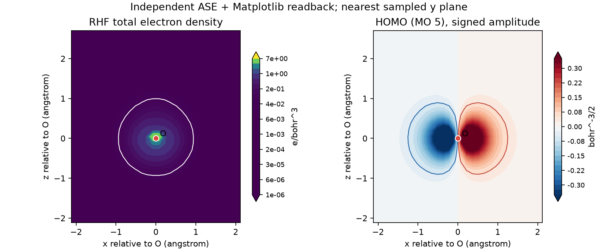
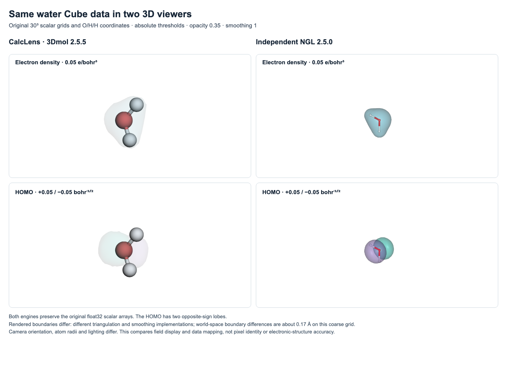

# Real electronic calculation: isolated water

This case contains the output of an actual PySCF 2.12.0 calculation, run on
2026-11-05. It demonstrates two partial-charge methods, total electron density
and a signed molecular orbital from the same converged wavefunction. The
[original XYZ input](../examples/electronic_case/source/water.xyz),
[preparation script](../scripts/prepare_electronic_case.py),
[SCF log](../examples/electronic_case/scf.log) and
[calculation metadata](../examples/electronic_case/calculation.json) are included.
The artificial format fixtures used in viewer tests are separate from this case.

## Calculation and geometry

The job is a closed-shell, neutral, isolated H₂O molecule treated with restricted
Hartree–Fock (RHF) and the minimal STO-3G basis: 10 electrons in 7 atomic basis
functions, no effective core potential and no frozen core. The fixed input is an
illustrative model chosen for this example; it is not a deposited experimental
structure. No geometry optimization was performed. The calculation follows the
[PySCF molecular RHF interface](https://pyscf.org/quickstart.html#hartree-fock).

| Quantity | Recorded result |
| --- | --- |
| Total energy, including nuclear repulsion | −74.9630631297292 hartree |
| SCF convergence | 8 cycles; converged |
| Energy threshold | 10⁻¹² hartree |
| Orbital-gradient threshold | 10⁻⁸ |
| HOMO | MO 5 in one-based order; occupation 2 |
| HOMO eigenvalue | −0.391274218954771 hartree |
| Original atom order | O, H, H |

The original Cartesian coordinates in ångströms are O = (0, 0, 0), H =
(0, 0.757, 0.587) and H = (0, −0.757, 0.587). The preparation translates all
three atoms by (+6, +6, +6) Å and places the translated coordinates in a
12 × 12 × 12 Å orthogonal P1 CIF. The SCF calculation and both Cube files use
those same translated coordinates and atom order. No rotation or permutation
is applied.

**The CIF cell is a display container. The electronic calculation is molecular,
with no periodic boundary conditions.** A large gap reported by CalcLens for
this container does not establish slab-vacuum convergence or a periodic solid's
electronic properties. RHF/STO-3G is a compact teaching example; convergence of
this job does not establish chemical accuracy, basis convergence or agreement
with experiment.

## Load and compare the data

To open the finished workspace directly, choose **Open project** and load
[real-water.calclens.zip](../examples/electronic_case/real-water.calclens.zip)
in CalcLens 0.7.0 or later. It embeds the CIF, both charge JSONs and both Cube
files, with independent comparison cameras and a shared charge-color range.
The left viewer shows Mulliken charges and density; the right shows Löwdin
charges and the HOMO. Both surfaces use magnitude 0.05 and opacity 0.35.

The saved [comparison view](../examples/electronic_case/real-water-comparison.png)
and native **1600 × 838** PNG exports for
[density](../examples/electronic_case/real-water-density.png) and
[HOMO](../examples/electronic_case/real-water-homo.png) show that workspace.
These files are generated app outputs, separate from the byte-verified
scientific artifacts in `manifest.json`.

To build the same workspace from the original files:

1. Upload [water.cif](../examples/electronic_case/water.cif).
2. Import [charges_mulliken.json](../examples/electronic_case/charges_mulliken.json)
   and [charges_lowdin.json](../examples/electronic_case/charges_lowdin.json)
   as two partial-charge datasets. Each includes the exact original CIF SHA-256
   and one-based O/H/H indices. The CSV copies are for inspection outside the app.
3. Compare the two named charge datasets. They partition the same RHF density;
   the geometry and electronic method have not changed.
4. Import one Cube at a time with the explicit selections below. Use
   `PySCF 2.12.0; isolated H2O RHF/STO-3G; calculation.json` as its source.
   Set the isovalue to 0.05 and apply it after import.

| File | Field kind | Scalar units | Display isovalue |
| --- | --- | --- | --- |
| [density.cube](../examples/electronic_case/density.cube) | Electron density | `e/bohr^3` | 0.05 e/bohr³ |
| [homo.cube](../examples/electronic_case/homo.cube) | Orbital | `bohr^-3/2` | ±0.05 bohr⁻³ᐟ² |

These thresholds were chosen to display the example clearly; they are not
physical boundaries or convergence criteria. The orbital's two colors show
opposite wavefunction signs. They do not show positive and negative electron
charges. An overall orbital sign reversal represents the same state; this
export makes the largest-magnitude AO coefficient positive for a reproducible
phase convention.

| Atom | Mulliken charge (e) | Symmetric Löwdin charge (e) | Mulliken − Löwdin (e) |
| --- | ---: | ---: | ---: |
| 1: O | −0.3655097694 | −0.2528688841 | −0.1126408854 |
| 2: H | +0.1827548847 | +0.1264344420 | +0.0563204427 |
| 3: H | +0.1827548847 | +0.1264344420 | +0.0563204427 |

Mulliken uses the AO overlap population `diag(P S)`. The second dataset uses
full symmetric Löwdin orthogonalization, `diag(S^(1/2) P S^(1/2))`, with no
pre-orthogonalization or meta-Löwdin partition. Each atom's electron population
is subtracted from its nuclear charge. The implementation uses PySCF's
[Mulliken routine](https://pyscf.org/_modules/pyscf/scf/hf.html#mulliken_pop)
and [symmetric Löwdin orthogonalizer](https://pyscf.org/_modules/pyscf/lo/orth.html#lowdin).
Both datasets sum to zero within floating-point rounding. Their difference
illustrates method dependence; neither dataset is an oxidation-state or formal
charge assignment.

## Cube conventions and numerical checks

PySCF's [cubegen exporter](https://pyscf.org/_modules/pyscf/tools/cubegen.html)
evaluated each field on a 30 × 30 × 30 endpoint-inclusive grid with a 4 Bohr
margin around the molecular bounding box. Each file contains 27,000 values and
is under 0.4 MiB. All voxel counts are positive: spatial origin, step vectors
and atom coordinates are in Bohr. The z index changes fastest. Scalar values
use the normal PySCF six-significant-digit Cube output. Only the second,
date-containing comment line was replaced; the numerical export was preserved.

The [recorded checks](../examples/electronic_case/independent_check.json) use
three complementary paths:

- NumPy reconstructs the RHF Fock matrix, energy, electron count and both charge
  partitions from the exported [wavefunction matrices](../examples/electronic_case/wavefunction.json).
  The reconstructed total energy differs by 1.42 × 10⁻¹⁴ hartree, `Tr(P S)` is
  10.0, and the largest Roothaan-equation residual is 1.25 × 10⁻¹⁰.
- ASE 3.29.0's [Cube reader](https://gitlab.com/ase/ase/-/blob/3.29.0/ase/io/cube.py)
  reads both files independently of the CalcLens and PySCF Cube parsers. Atom
  ordering, coordinates, grid shape and scalar arrays agree with the exported
  calculation within format rounding. The maximum absolute export error is
  4.77 × 10⁻⁶ for density and 5.00 × 10⁻⁷ for the orbital.
- A separate PySCF atom-centered level-5 quadrature gives 9.9999999895 electrons
  over 90,064 points, an absolute error of 1.06 × 10⁻⁸ relative to 10.

The coarse display Cube gives only **9.1780 electrons** under trapezoidal
integration: its uniform grid undersamples the sharp oxygen core density. Do
not use it for quantitative electron integration. The HOMO squared integral
on the same finite grid is 0.9999523. These checks establish exported-data
consistency; the integrals and AO evaluator still originate from PySCF. No
second electronic-structure code or experimental benchmark was used.

The figure below is a separate visualization made from the files read by ASE.
It shows x/z sections at the grid plane nearest the oxygen's y coordinate;
the hydrogens lie outside that section. The white density contour and the two
orbital contours use the isovalues above. It is a numerical readback reference,
not a screenshot of another molecular viewer.



## Independent 3D viewer comparison

The same original `density.cube` and `homo.cube` files were also displayed in
**NGL 2.5.0**, independently of CalcLens's 3Dmol 2.5.5 renderer. The
[comparison figure](../examples/electronic_case/independent_viewer/comparison.png),
[NGL screenshots](../examples/electronic_case/independent_viewer/ngl-reference.png)
and [numerical record](../examples/electronic_case/independent_viewer/comparison.json)
come from local Chromium sessions on 2026-11-05. Scientific files were served
only on loopback; they were not sent to an external viewer service.

Both viewers used the original 27,000 scalar values per file, the same O/H/H
coordinates, density level **0.05 e/bohr³**, orbital levels **±0.05 bohr⁻³ᐟ²**,
opacity **0.35**, perspective projection and one smoothing iteration. NGL was
explicitly set to `isolevelType: 'value'`: its default is sigma scaling, which
would represent a different threshold. This behavior is specified in the
[NGL surface implementation](https://github.com/nglviewer/ngl/blob/v2.5.0/src/representation/surface-representation.ts).

The comparison script verifies identical SHA-256 hashes of the float32 scalar
arrays delivered to both renderers, atomic elements/order and positions within
10⁻⁶ Å. It also checks NGL's complete grid-to-world coordinate matrix against
the Cube header. NGL's [Cube parser](https://github.com/nglviewer/ngl/blob/v2.5.0/src/parser/cube-parser.ts)
uses 0.529177210859 Å/Bohr; CalcLens uses 0.529177210903 Å/Bohr. That small
conversion difference is included in the check; scalar units are unchanged.
NGL does not read the embedded Cube atom records into a molecular structure,
so its atom model is a PDB export of the same translated input coordinates,
included as `water-display.pdb`.

Both displays show a molecular density envelope and two opposite-sign HOMO
lobes. Their mesh boundaries differ on this coarse grid:

| Surface | NGL vertices | CalcLens/3Dmol vertices | Largest difference between world-space bounds |
| --- | ---: | ---: | ---: |
| Density, +0.05 | 684 | 344 | 0.169895 Å |
| HOMO, +0.05 | 428 | 216 | 0.165572 Å |
| HOMO, −0.05 | 428 | 216 | 0.165572 Å |

The largest bidirectional nearest-vertex distance is 0.198227 Å, approximately
one maximum voxel interval (0.198187 Å). This is a comparison of mesh vertices,
not a continuous-surface error estimate. The implementations explain why equal
numeric settings do not give identical meshes:
[3Dmol thresholds the data to a binary mask before meshing](https://github.com/3dmol/3Dmol.js/blob/2.5.5/src/GLShape.ts),
while [NGL interpolates scalar edge crossings](https://github.com/nglviewer/ngl/blob/v2.5.0/src/surface/marching-cubes.ts).
They also implement smoothing separately. Camera orientation, atom radii and
lighting differ in the screenshots. This check establishes the input mapping
and qualitative 3D display; it does not establish identical boundaries,
grid convergence or electronic-structure accuracy.



The [reproduction script](../scripts/compare_electronic_viewers.py) uses an
optional NGL installation outside the application. With the CalcLens browser
test environment available, reproduce the comparison with:

```sh
npm install --prefix work/ngl-reference --no-save --ignore-scripts ngl@2.5.0
python scripts/compare_electronic_viewers.py \
  --ngl-bundle work/ngl-reference/node_modules/ngl/dist/ngl.js \
  --output work/browser/independent-viewer
```

The script starts its own isolated CalcLens and NGL loopback servers. The
reference [manifest](../examples/electronic_case/independent_viewer/manifest.json)
records the script and output hashes; `comparison.json` records the NGL bundle,
browser versions, input hashes and measured mesh differences. NGL is not an
application runtime dependency.

별도의 3D 뷰어인 NGL에서도 같은 원본 Cube와 절대 등가면 값 0.05를 사용했습니다.
입력 배열과 원자 좌표는 일치했지만, 서로 다른 표면 생성 방식 때문에 경계에는 약
0.17 Å 차이가 있었습니다. 두 로브의 배치와 부호는 확인했으며, 완전히 같은 표면이나
화학적 정확도를 검증한 것으로 해석하지 않습니다.

## Reproduce or verify

Checking the bundled results needs the normal CalcLens development environment
and does not import PySCF or use the network:

```sh
python scripts/prepare_electronic_case.py --check
PYTHONPATH=src python -m pytest tests/test_electronic_case.py -q
```

To run the electronic calculation again, create a separate Python 3.12
environment and install the optional case requirements. They are not CalcLens
runtime dependencies:

```sh
python3.12 -m venv work/electronic-venv
work/electronic-venv/bin/python -m pip install -r examples/electronic_case/requirements.txt
work/electronic-venv/bin/python scripts/prepare_electronic_case.py --output-dir work/electronic-recomputed
```

The committed run used Python 3.12.16, PySCF 2.12.0, NumPy 2.5.4, SciPy 1.18.1,
h5py 3.16.0 and ASE 3.29.0. Recalculation can produce small numerical differences
across platforms and math libraries. `--check` verifies the committed byte
hashes and numerical invariants; it does not require a new run to produce
identical bytes. [manifest.json](../examples/electronic_case/manifest.json)
binds the artifacts and preparation script to SHA-256 hashes. A fresh run in
another directory creates its own manifest.

## 한국어 안내

완성된 작업은 CalcLens 0.7.0 이상에서 **작업 열기**를 누르고
[real-water.calclens.zip](../examples/electronic_case/real-water.calclens.zip)을
선택하면 바로 볼 수 있습니다. 구조·전자 자료 4개·비교 시점·공통 전하 범위가
함께 들어 있습니다. 왼쪽은 Mulliken 전하와 전자밀도, 오른쪽은 Löwdin 전하와
HOMO입니다. 위의 PNG 링크에서 앱이 출력한 최종 그림도 확인할 수 있습니다.

이 자료는 PySCF로 실제 실행한 고립된 물 분자의 RHF/STO-3G 계산 결과입니다.
원자 좌표는 설명용 고정 모델이며 실험 구조나 최적화된 구조가 아닙니다. CIF의
12 Å 셀은 뷰어에 표시하기 위한 공간이고, 주기적 고체 계산에는 사용되지 않았습니다.

`water.cif`를 연 뒤 두 전하 JSON을 함께 불러오면 같은 전자밀도를 Mulliken과
대칭 Löwdin 방식으로 나눈 차이를 비교할 수 있습니다. `density.cube`는 전자밀도와
`e/bohr^3`, `homo.cube`는 오비탈과 `bohr^-3/2`를 선택하세요. 두 파일 모두 표시용
등가면 값으로 0.05를 사용할 수 있습니다. 오비탈 색은 파동함수의 부호이며 전하의
부호가 아닙니다.

계산은 수렴했고 파일·좌표·행렬의 일치도 확인했습니다. 다만 작은 기저함수와 성긴
표시용 격자를 사용했으므로 화학적 정확도나 고체의 성질을 검증한 사례로 해석하면
안 됩니다. 전자밀도 Cube의 적분값은 9.1780 전자로, 정량 적분용 자료가 아닙니다.
