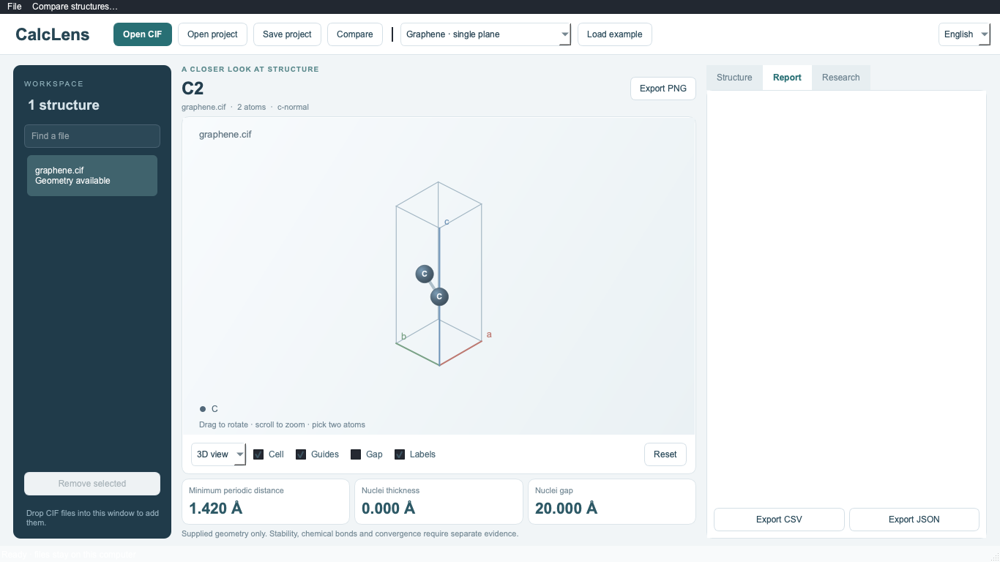
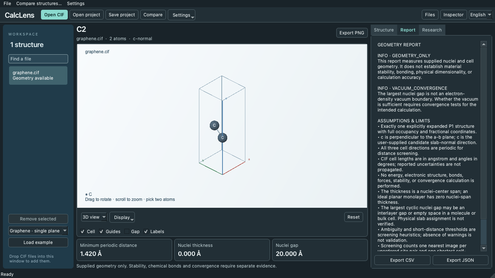
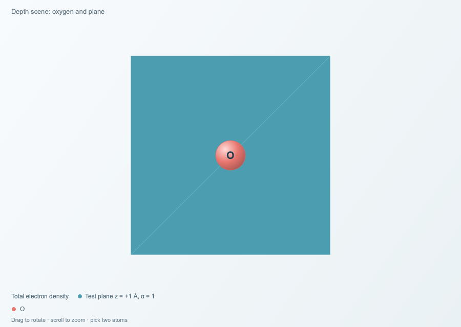
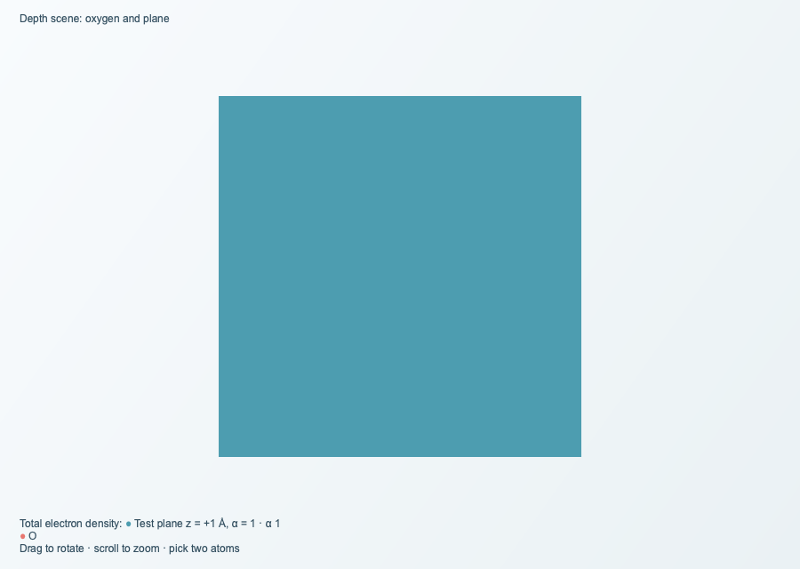

# CalcLens 0.9.0 네이티브 데스크톱 검증 기록

기준은 공개 0.9.0 커밋 `d6e9acf4c3ee572d295276af97d22ba22abf30cb`입니다. 수정 브랜치는 `fix/native-desktop-feedback-090`입니다. 검토 파일은 같은 버전 번호를 쓰며 파일명에 `review`가 들어갑니다.

## 저장과 과학 자료

| 기준 버전에서 재현한 동작 | 수정 후 확인한 동작 |
| --- | --- |
| H₂의 c축 Δρ 계산 후 구조 축을 a로 바꾸면 저장은 성공하지만 재열기에서 격자면 오류가 났습니다. 검증이 현재 구조 축을 사용했습니다. | 같은 순서로 저장하고 다시 열었습니다. 원본 AB/A/B의 바이트와 해시, 파생 Cube, 계산 기록, 메모가 일치했습니다. 연구 패널에 보관된 c축과 현재 a축의 차이가 표시됩니다. |
| 물 밀도 평면 평균을 구하고 HOMO를 선택해도 같은 구조 해시의 그래프와 내보내기가 남았습니다. 장치 확인도 계산과 같은 작업 키를 사용했습니다. | 자료 ID, 원본 해시, 물리량, 단위, 작업, 축·법선과 입력 조건을 확인합니다. HOMO 선택 뒤 빈 그래프와 비활성 CSV·JSON 버튼을 확인했습니다. 지연된 계산 도중 자료·축·조각·실행 위치를 변경하는 테스트와 장치 확인을 동시에 실행하는 테스트가 통과했습니다. |
| 별도 계산 기록에는 프로파일만 들어 있었습니다. | JSON에 스키마, 원본 파일명·해시, 조각 매핑, 동결 기하 확인, 방법·조건, 격자·단위, 실행 장치·정밀도·시간·CPU 검산이 들어 있습니다. 프로젝트, CSV, JSON, Cube, PNG에서 자료 식별 정보와 단위를 대조했습니다. |

저장은 실제로 기록할 ZIP 바이트를 정상 열기 경로와 같은 검증에 통과시킨 뒤 파일을 원자적으로 교체합니다. 연구 탭을 열기 전에 구조를 삭제하는 경우, 자동 복구본·미적용 메모, 손상된 입력 거부, 기존 파일 보호도 검사했습니다. 현재 축으로 기하 분석이 안 되면 원본 CIF와 보관 계산을 열어 확인할 수 있습니다. **출처 상세 → 원본 CIF 저장**은 P1 준비 전의 원본 바이트도 보존합니다.

기존 프로젝트의 바깥 ZIP 형식은 그대로 읽습니다. 이전 Δρ 기록에는 원래 슬랩 법선의 방향이나 최초 실행 장치·시간이 없을 수 있습니다. 원본 Cube 기저와 기록된 평면 축으로 법선을 재구성하고 CPU로 검산했다는 사실을 표시합니다. 명시적인 새 축은 원본 CIF의 셀 벡터와 대조합니다. 점유율, 무질서, 변조 구조, P1·명시적 대칭 전개 범위와 원본 해시·크기 제한을 계속 검사합니다.

## 테마, 화면과 그래픽

어두운 시스템 팔레트를 주입했을 때 기준 버전에서 보고서의 `Text`와 `Base`는 둘 다 흰색이었습니다. 새 버전의 보고서 대비는 라이트 13.12:1, 다크 12.37:1이었습니다. 영어와 한국어의 실제 위젯에서 측정했습니다.

| 다크 팔레트 · 수정 전 | 다크 팔레트 · 수정 후 |
| --- | --- |
|  |  |

넓은 창에서는 파일 목록, 구조 뷰, 검사 패널을 함께 표시합니다. 683×384 논리 픽셀에서는 상단 버튼으로 파일·구조·검사 패널을 전환합니다. 1920×1080, 1366×768, 1093×614, 911×512, 683×384를 두 언어로 열어 창 크기와 입력 영역을 확인했습니다. Mac Cocoa의 실제 Retina 화면(DPR 2)에서도 두 언어, 비교 창, 오류, 내보내기 창을 캡처했습니다. Windows의 125/150/200%에 해당하는 논리적 크기를 시험했으며 실제 Windows 모니터 배율 전환은 미검증입니다.

| 불투명 평면 · 수정 전 | 같은 장면 · 수정 후 |
| --- | --- |
|  |  |

앞쪽 불투명 평면 뒤 원자는 기준 버전에서 선택 ID 0을 반환했습니다. 수정 후 같은 위치에서 선택 결과는 -1이었습니다. 평면이 뒤에 있거나 반투명이면 보이는 원자를 선택할 수 있습니다. 원본 물 격자의 등치값 0.05 e/ų과 삼각형 7,624개를 세 품질 수준에서 보존했습니다. PNG는 화면 조작 품질과 별도로 다시 그리며 긴 출처와 단위가 들어가도록 설명 영역의 높이를 조정합니다. [표현 방식, PNG, 웹 뷰어 비교 및 한계](native-graphics.md)

## Windows 시작과 오류 진단

공개 EXE는 NSIS solid LZMA 런타임을 실행할 때마다 임시 폴더로 풉니다. 검토 ZIP은 한 번 풀어 둔 폴더의 `runtime`을 사용합니다. 앱은 첫 창을 그린 뒤 기본 구조를 백그라운드에서 분석하고, 연구 패널은 처음 사용할 때 만듭니다. 소스 실행 경로는 `run_app.py → desktop_entry.py → desktop.py`입니다. Windows 실행 파일은 번들 Python과 `windows_bootstrap.py`를 거쳐 같은 네이티브 앱을 시작합니다. 런타임 또는 Qt를 제거한 오류 시험에서 오류창·로그와 실패 종료 상태를 확인했습니다. [빌드 및 진단 안내](../packaging/desktop/windows-portable-build.md)

**네이티브 Windows 시작 시간은 미측정입니다.** 이 Mac에서 Parallels 서비스를 연결할 수 없었고, 실행할 수 있는 Windows 게스트가 없었습니다. 아래 값은 Apple M5, 24 GB, macOS 27.2, Wine 11.0, Qt offscreen에서 측정한 Windows 실행 파일의 값입니다. 같은 앱 소스와 런타임을 두 형식으로 포장했습니다. 값은 관측 첫 실행과 두 번의 반복 실행 순서이며 단위는 초입니다. OS 캐시를 비우지 않았습니다.

| 측정 지점 | 매번 푸는 NSIS | 한 번 푸는 폴더 ZIP |
| --- | --- | --- |
| 실행 중 런타임 압축 해제 | 12.312 / 12.180 / 12.192 | 0 / 0 / 0 |
| Qt 모듈 import | 0.214 / 0.205 / 0.210 | 0.216 / 0.201 / 0.202 |
| 과학 모듈 import | 0.696 / 0.678 / 0.709 | 0.704 / 0.685 / 0.703 |
| QApplication 초기화 | 0.037 / 0.036 / 0.038 | 0.037 / 0.038 / 0.039 |
| 실행 → 실제 메인 창 | 15.485 / 14.314 / 14.284 | 3.002 / 1.790 / 1.820 |
| 실행 → 기본 분석 적용 | 17.683 / 16.466 / 16.502 | 5.178 / 3.992 / 4.382 |
| 실행 → 준비된 창의 첫 키 이벤트 처리 | 17.683 / 16.494 / 16.502 | 5.178 / 3.992 / 4.382 |

외부 관측은 25 ms 간격이므로 두 이정표가 같은 시각으로 기록될 수 있습니다. 기본 분석 직후 Qt에 보낸 키 이벤트의 실제 처리를 확인했습니다. ZIP 최초 해제는 호스트 Python에서 1.315초였습니다. 공개 0.9.0 원본 EXE에서 기존 검증과 종료를 포함한 전체 시간은 23.789 / 20.079 / 20.856초였습니다. 이 원본은 준비 완료 시각을 별도로 기록하지 않습니다.

통합 수정까지 반영한 검토 ZIP에서 런타임 파일 8,404개를 검사했습니다. 동봉 문서 이미지를 추가하기 전, 같은 앱 코드로 만든 실행 파일의 첫 메인 창은 3.100 / 2.023 / 2.244초, 입력 처리는 5.586 / 4.654 / 4.827초였습니다. 이 번들의 Windows Python·Qt에서도 H₂ 저장·재열기와 물 HOMO 전환을 다시 실행했습니다. 전달용 ZIP 자체의 해시·시작 측정·검증은 함께 제공한 검증 보고서에서 확인할 수 있습니다.

## 계산 장치

| 선택 | 지원 범위 | 이 환경에서 검증한 내용 |
| --- | --- | --- |
| Auto | 사용 가능한 로컬 장치를 실제 작업으로 비교합니다. | 작은 격자와 거리에서 CPU 선택, 사유·시간·검산 기록을 확인했습니다. |
| CPU | NumPy float64 | Apple Silicon 로컬 및 Wine의 x64 번들에서 검증했습니다. |
| Apple Metal | 제공되는 Apple Silicon Metal 런타임 | Apple M5 float32 밀도·평면·거리 연산 및 CPU 검산을 실행했습니다. 독립 작은 격자 검사의 최대 절대 오차는 약 1.52×10⁻⁷이었습니다. |
| NVIDIA CUDA | Windows/Linux NVIDIA 장치와 드라이버 | 이 Mac에는 CUDA 장치가 없어 불가 사유와 선택 비활성화를 확인했습니다. 실제 NVIDIA 장치 연산은 미검증입니다. |
| CalcLens 원격 워커 | 인증한 수치 워커, 원격 호스트는 검증된 HTTPS 필요 | 인증한 루프백 CPU/Metal 워커, 장치 정책, 실제 연산, CPU 검산, timeout과 연결 취소를 검증했습니다. 외부 HTTPS 서버는 미검증입니다. |

화면 렌더러는 CPU 소프트웨어 렌더러입니다. 장치 선택은 밀도 격자 차이, 평면 평균, 일부 원자쌍 거리 연산에 적용됩니다. Gaussian 로그 읽기와 DFT 실행은 별도 기능이며 CalcLens는 Gaussian 작업 제출을 제공하지 않습니다.

## 재검증

환경은 macOS 27.2 arm64, Python 3.12.16, PySide6 6.12.0, NumPy 2.5.4, ASE 3.29.0입니다. Windows 번들은 CPython 3.13.17 x64입니다.

```sh
QT_QPA_PLATFORM=offscreen PYTHONPATH=src python -m pytest -q -ra
python -m ruff check src tests scripts run_app.py
(cd frontend && npm ci --ignore-scripts && npm test && npm run build)
git diff --check
```

Python **1,266개 통과, 3개 건너뜀**. 독립 PySCF 환경이 필요한 예제 재생성 1개와 Windows PowerShell 워크플로 2개입니다. ASE에서 NumPy 폐기 예정 경고 11개가 발생했습니다. 웹 테스트 **63개 통과**, TypeScript/Vite 빌드 및 기존 웹 배포 자산 일치 확인, Ruff 통과입니다. Mac DMG는 읽기 전용으로 마운트해 서명을 검사하고, 그 안의 앱에서 한국어 번들 검증과 영문 일반 실행 경로를 확인했습니다.

핵심 변경 파일은 `density_records.py`, `desktop_research.py`, `web_api.py`(보관·검증), `desktop.py`, `desktop_theme.py`, `desktop_preferences.py`, `desktop_devices.py`, `compute_server.py`(화면·설정·워커), `desktop_view.py`, `desktop_raster.py`, `desktop_compare.py`(그래픽), `build_portable_windows.py`, `startup.py`, `desktop_entry.py`, `windows_bootstrap.py`(실행·진단)입니다. [그래픽 수치 검증 파일](verification/native-graphics.json)
